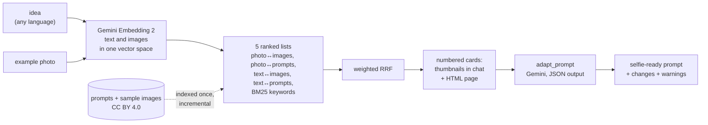

# Prompt Scout

An MCP server that finds image-generation prompts by **idea**, by **example photo**, or both, in a library of
15,000+ community prompts for Google's Nano Banana models, and adapts the chosen prompt for
**selfie-based generation** (the person comes from the user's photo; the look comes from the prompt).

I built it for [ImagineMe](https://imagine-me.ru), my AI photoshoot service: finding and tuning new styles
was the slowest part of the product. The workflow now: in Claude, describe an idea or drop in a reference
picture → see numbered cards with sample results → "№2, adapt it" → test in the product's style lab.



## How search works

Every prompt gets two vectors from **Gemini Embedding 2**, a multimodal model that places text and images in
the same space: one for its text (title, description, prompt) and one for its **sample image**.
A query can be text, a photo, or both, and is compared with both kinds of vectors:

| List | Finds |
|---|---|
| photo ↔ sample images | results that *look* like your photo (marketplace-style image search) |
| photo ↔ prompt text | prompts whose wording matches what is in the photo (weaker, weight 0.5) |
| text ↔ sample images | results that look like your words, even when the prompt says it differently |
| text ↔ prompt text | prompts that mean the same, across languages |
| BM25 keywords | exact terms: "Polaroid", "ukiyo-e" |

The lists are merged with weighted Reciprocal Rank Fusion: each prompt scores `weight / (60 + rank)` per list,
so there are no score scales to calibrate. Searching sample images matters because prompt text often does not
say what makes the result work: a "Hollywood portrait" prompt may owe everything to a hard on-camera flash.

## Tools

| Tool | What it does |
|---|---|
| `search_prompts(query, image, limit, with_reference, category)` | Text, photo (path or URL), or both. Returns numbered results with thumbnails in chat and opens an HTML page with the same numbered cards (copy-prompt buttons). `with_reference=true` keeps prompts built around a reference photo. |
| `get_prompt(prompt_id)` | Full prompt and metadata. |
| `adapt_prompt(prompt_id, wish)` | Rewrites the prompt for a selfie service: strips face, age and ethnicity descriptors and real-person names, adds an identity-preservation instruction, and merges the user's wish into one coherent prompt instead of appending it. Returns the prompt, a list of changes, extra references needed, and warnings. |
| `list_categories()` | Indexed categories with counts. |

This is retrieval-augmented generation: `adapt_prompt` generates from a retrieved prompt, and the MCP client
(Claude) composes its answer from the search results.

## Quick start

```bash
pip install git+https://github.com/vshgit/prompt-scout
export GEMINI_API_KEY=...

prompt-scout init                  # writes ~/.prompt-scout/config.toml (portraits only by default)
prompt-scout fetch                 # download the library (~60 MB JSON)
prompt-scout index --limit 100     # cheap trial
prompt-scout index                 # downloads sample images, embeds texts and images
prompt-scout search "голливудский портрет со вспышкой" --open
prompt-scout search --image ~/Downloads/look.jpg --open

claude mcp add prompt-scout -e GEMINI_API_KEY=$GEMINI_API_KEY -- prompt-scout serve
```

Cost with Gemini Embedding 2 paid tier: portraits only (~2,200 prompts) ≈ $0.45; the whole library
(~15,300 prompts) ≈ $3. Each search embeds one short query (fractions of a cent).

## Configuration

`~/.prompt-scout/config.toml`:

```toml
[library]
categories = ["profile-avatar"]   # add "social-media-post", ... (counts listed in the file)
exclude_ids = ["553"]             # prompts you never want to see
images = true                     # index sample images (needed for photo and look search)

[preview]
open_browser = true               # open the results page after each search
thumbnails_in_chat = true
```

After editing, run `prompt-scout index` again. Indexing is incremental: unchanged prompts and images keep
their vectors; only new or edited ones are embedded. The library itself updates twice a day upstream
(`prompt-scout fetch`).

## Design decisions

- **No vector database.** Thousands of 768-dim vectors are tens of MB; exact search in numpy takes
  milliseconds. Persistence is plain files (`text_vectors.npy`, `image_vectors.npy`, `records.jsonl`, `meta.json`).
- **One multimodal model** for texts, images and queries, so every comparison is in one space.
  Vectors are re-normalized after truncation to 768 dims.
- **Image cache.** Sample images are downloaded once, shrunk to 640 px JPEG, and reused for embeddings,
  chat thumbnails and the offline results page.
- **Structured output** for the generation step (JSON mode), so the tool returns stable fields.
- **Testable without network.** Tool logic lives in `service.py`, separate from MCP; tests use a hashing
  embedder and fake Gemini clients built with the real SDK types. `--embedder hash` builds an offline index.

Environment: `PROMPT_SCOUT_HOME` (default `~/.prompt-scout`), `PROMPT_SCOUT_EMBED_MODEL`
(default `gemini-embedding-2`), `PROMPT_SCOUT_EMBED_DIM` (768), `PROMPT_SCOUT_LLM_MODEL` (`gemini-flash-latest`).

## Development

```bash
pip install -e ".[dev]" && pytest
```

## Data and license

Code: MIT. The prompt library is **not** included in this repository; `prompt-scout fetch` downloads it from
[YouMind-OpenLab](https://github.com/YouMind-OpenLab/nano-banana-pro-prompts-recommend-skill), licensed
[CC BY 4.0](https://creativecommons.org/licenses/by/4.0/). The prompts were collected from their community
authors; every result carries a `source_url` for attribution.
