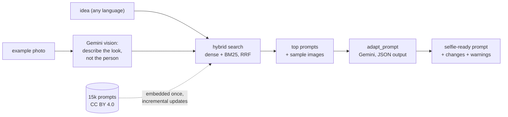

# Prompt Scout

An MCP server that finds image-generation prompts by **idea** or by **example photo** in a library of
15,000+ community prompts for Google's Nano Banana models, and adapts the chosen prompt for
**selfie-based generation** (the person comes from the user's photo; the look comes from the prompt).

I built it for [ImagineMe](https://imagine-me.ru), my AI photoshoot service: finding and tuning new styles
was the slowest part of the product. The workflow now: describe an idea in Claude Code, or drop in a reference
picture → get matching prompts with their sample images → adapt one → test it in the product's style lab.



## Tools

| Tool | What it does |
|---|---|
| `search_prompts(query, limit, with_reference, category)` | Semantic + keyword search. Queries in any language (Russian queries find English prompts). `with_reference=true` keeps prompts built around a reference photo. |
| `search_by_image(image, limit, with_reference, category, extra)` | A vision model describes the image's style (never the identity of people in it), then that description is searched. `extra` adds wishes: "but at night". |
| `get_prompt(prompt_id)` | Full prompt and metadata. |
| `adapt_prompt(prompt_id, wish)` | Rewrites the prompt for a selfie service: strips face, age and ethnicity descriptors and real-person names, adds an identity-preservation instruction, and merges the user's wish into one coherent prompt instead of appending it. Returns the prompt, a list of changes, extra references needed, and warnings. |
| `list_categories()` | Categories with counts. |

This is retrieval-augmented generation in two places: `adapt_prompt` generates from a retrieved prompt,
and the MCP client (Claude) composes its answer from the search results.

## Quick start

```bash
pip install git+https://github.com/vshgit/prompt-scout
export GEMINI_API_KEY=...

prompt-scout fetch                 # download the library (~60 MB JSON) to ~/.prompt-scout
prompt-scout index --limit 300     # cheap trial run
prompt-scout index                 # full index: ~15k prompts, ~5.7M tokens, about $1
prompt-scout search "фото в стиле 90-х, вспышка" --with-reference yes

claude mcp add prompt-scout -e GEMINI_API_KEY=$GEMINI_API_KEY -- prompt-scout serve
```

Re-run `fetch` + `index` to pick up new prompts: unchanged prompts keep their vectors, only new or edited
ones are embedded.

## Design decisions

- **No vector database.** 15k × 768 float32 is ~45 MB; exact cosine search in numpy takes milliseconds.
  Persistence is three files (`vectors.npy`, `records.jsonl`, `meta.json`).
- **Hybrid retrieval.** Dense embeddings (`gemini-embedding-001`, multilingual, 768 dims, re-normalized after
  truncation) handle meaning and cross-language queries; BM25 catches exact terms such as "Polaroid" or
  "ukiyo-e". Rankings are fused with Reciprocal Rank Fusion, so there are no score scales to tune.
- **Image search through text.** The photo is turned into a style description and then searched, rather than
  embedded directly. This keeps the step controllable (describe the look, ignore the person) and inspectable:
  the tool returns the description it searched with.
- **Structured output.** Both LLM steps use JSON mode, so the tools return stable fields.
- **Incremental indexing** by content hash: the library updates twice a day.
- **Testable without network.** Tool logic lives in `service.py`, separate from MCP; tests use a hashing
  embedder and fake LLM/SDK clients. An offline index (`--embedder hash`) runs the whole server without an API key.

Settings: `PROMPT_SCOUT_HOME` (default `~/.prompt-scout`), `PROMPT_SCOUT_EMBED_MODEL`,
`PROMPT_SCOUT_EMBED_DIM`, `PROMPT_SCOUT_LLM_MODEL` (default `gemini-flash-latest`).

## Development

```bash
pip install -e ".[dev]" && pytest
```

## Data and license

Code: MIT. The prompt library is **not** included in this repository; `prompt-scout fetch` downloads it from
[YouMind-OpenLab](https://github.com/YouMind-OpenLab/nano-banana-pro-prompts-recommend-skill), licensed
[CC BY 4.0](https://creativecommons.org/licenses/by/4.0/). The prompts were collected from their community
authors; every result carries a `source_url` for attribution.
